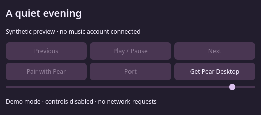

# YouTube Music desktop remote

[](https://github.com/0xSaadBinSultan/youtube-music-widget/actions/workflows/desktop.yml)

Desktop controls for [Pear Desktop](https://github.com/pear-devs/pear-desktop),
an independently installed YouTube Music client. The new Qt remote works on
**Windows, macOS and Linux**. The original GTK/XFCE wallpaper bar is still included.



| Platform | Remote interface | Player connection |
| --- | --- | --- |
| Windows 10/11 x64 | Qt window | Authenticated Pear local API |
| macOS 14+, Intel / Apple Silicon | Qt window | Authenticated Pear local API |
| Linux x64 X11 / Wayland | Qt window | Authenticated Pear local API |
| Debian/Kali XFCE X11 | Original GTK wallpaper bar | Local MPRIS, original player installer |

Qt windows support native dragging, resizing and adjustable transparency. Wallpaper
pinning is specific to the original XFCE version. CI builds Windows x64, Linux x64
and macOS Apple Silicon; check Actions for actual results. Source installations on
other architectures depend on Qt and Pear availability. Android and iOS are not supported.

## Portable setup

1. Install [Pear Desktop for your OS](https://github.com/pear-devs/pear-desktop/releases/latest)
   from its official releases. Open it, sign in if desired, and choose a song.
2. In Pear's plugins, enable **API Server**. Set its listening hostname to
   **127.0.0.1**, keep authentication enabled (`AUTH_AT_FIRST`), and use port **26538**.
   Pear versions can default to `0.0.0.0`; change that to `127.0.0.1` so your player
   controls are local to your computer. Consult your installed version's `/swagger`
   page for its API documentation.
3. Install Python **3.11 or 3.12**, then run:

```sh
git clone https://github.com/0xSaadBinSultan/youtube-music-widget.git
cd youtube-music-widget
python install_desktop.py --run
```

Use `python3` on macOS/Linux if needed, or `py -3.12` on Windows. The helper
installs dependencies in this checkout's `.venv`; it does not install Pear or
change its settings. Rerun the same command to launch again.

4. Click **Pair with Pear**, then approve the connection dialog in Pear Desktop.
   Pairing can wait up to two minutes. The remote stores the returned local token
   privately and then polls the current track every two seconds.
5. Use Previous, Play/Pause and Next. Pear must remain running. Closing this remote
   exits only the remote; it does not stop the player.

The Port button supports a different local port and clears the old token so you
can pair again. Remote hosts, redirects and HTTP proxies are deliberately excluded.
The remote uses `/auth/{id}`, `/api/v1/song`, `/api/v1/previous`,
`/api/v1/toggle-play` and `/api/v1/next`. It never reads browser cookies or Google tokens.
Upstream API bugs or changes can affect playback controls; no native player API is
emulated. This is a remote, not a streaming service or a subscription replacement.

## Preview and development

```sh
python install_desktop.py --run --demo
```

Demo mode uses synthetic text, disables controls and makes no player/network requests.
For your own environment:

```sh
python -m pip install -r requirements-desktop.txt
python desktop.py
python -m unittest -v test_portable
```

Tests use a real loopback test server to check pairing, bearer tokens, redirects,
commands and Unicode titles, plus an offscreen Qt preview and close check.

## Linux runtime libraries

Qt still needs the operating system's graphics and font libraries, including for
headless rendering. On Debian/Ubuntu/Kali desktops that lack them:

```sh
sudo apt install libegl1 libopengl0 libxkbcommon-x11-0 libxcb-cursor0 fonts-dejavu-core
```

Use your distribution's equivalent packages on other Linux systems. A standalone
build includes Python/Qt, but is not a fully static binary or a mobile application.

## Private storage

The local API token is in `connection.json` beneath:

- Windows: `%APPDATA%/youtube-music-widget`
- macOS: `~/Library/Application Support/youtube-music-widget`
- Linux: `$XDG_CONFIG_HOME/youtube-music-widget` or `~/.config/youtube-music-widget`

`MUSIC_WIDGET_HOME` overrides this directory for isolated testing. Keep it private;
it permits control of your local player. Token files use owner-only POSIX permissions
or the Windows user's inherited ACLs. The remote does not persist track information,
download artwork, collect analytics or contact a hosted backend. Remove its client
from Pear's authorized-client list to revoke access.

## Original XFCE bar

See [XFCE/MPRIS installation and behavior](docs/xfce.md). That version keeps its
existing process-verified media connection and needs no HTTP server. The Linux
installers and your existing services do not switch to the Qt version automatically.

## Standalone builds

```sh
python -m pip install pyinstaller
python -m PyInstaller --noconfirm --clean --onedir --windowed --name YouTubeMusicRemote desktop.py
```

Build on the target OS. GitHub Actions tests and builds Windows, macOS and Linux
artifacts; download a successful build's artifact from the Actions page. They are
unsigned builds, without Windows signing or macOS notarization. Pear must be installed
separately. Original source is [MIT](LICENSE); Pear and Qt/PySide retain their own
licenses and are not relicensed by this repository.

Previews can be regenerated with `python desktop.py --demo --export-preview docs/desktop-preview.png`.
